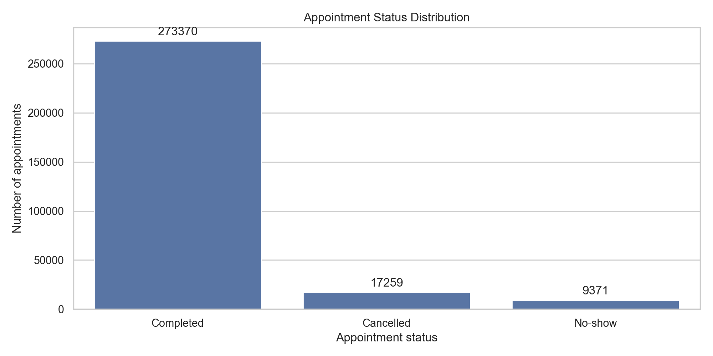
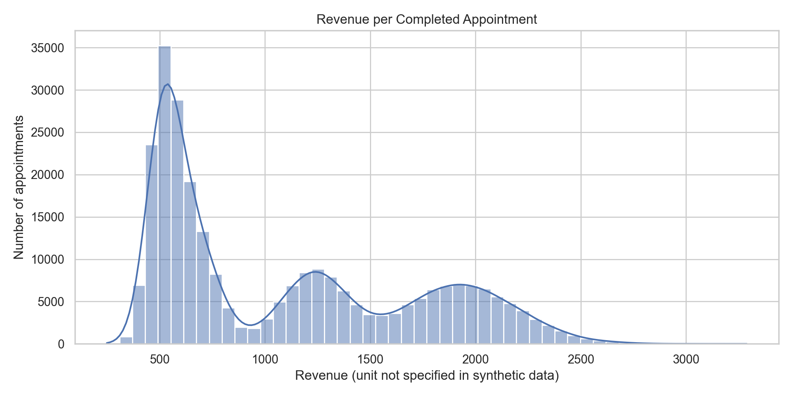
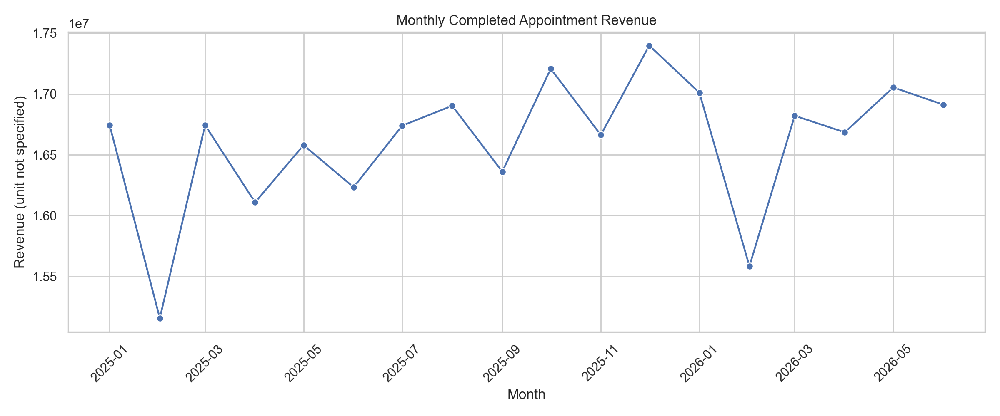
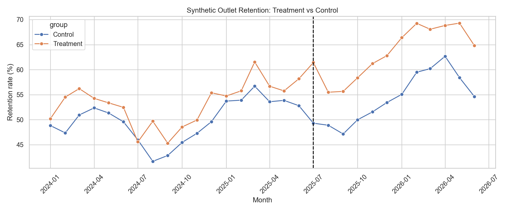

# Salon Experiment & Causal Analysis

### Customer Retention Improvement Through Appointment Reminders

An end-to-end Business Analytics and Causal Inference project exploring customer retention, appointment behavior, randomized A/B testing, CUPED variance reduction, and Difference-in-Differences (DiD).

> **Important:** This is a portfolio project built entirely with synthetic data. All business scenarios, experiment outcomes, and statistical findings are simulated and do not represent actual salon business results.

---

## Project Overview

Customer retention is an important business metric for appointment-based service businesses. This project demonstrates how a data analyst can investigate customer behavior, evaluate a hypothetical appointment reminder strategy, and apply statistical methods to estimate its impact.

The project includes operational data analysis and three separate synthetic analytical scenarios:

1. **Randomized A/B Experiment:** Evaluates the simulated effect of appointment reminders on 60-day customer retention.
2. **CUPED Analysis:** Demonstrates how pre-experiment customer activity can reduce outcome variance.
3. **Difference-in-Differences:** Demonstrates a historical outlet-level intervention analysis using a separate simulated dataset.

These scenarios are analyzed independently and are not treated as one continuous experiment.

## Business Problem

A fictional salon chain operating across 22 outlets wants to understand customer appointment behavior and explore whether appointment reminders could improve customer retention.

The analysis focuses on:

- Understanding appointment completion, cancellation, and no-show patterns.
- Measuring customer retention.
- Evaluating a hypothetical reminder intervention.
- Understanding treatment effects across customer segments.
- Applying advanced causal inference techniques.

## Project Objectives

- Perform data cleaning and exploratory data analysis.
- Build operational business KPIs.
- Design and evaluate a randomized A/B experiment.
- Validate randomization and sample ratio balance.
- Estimate treatment effects with confidence intervals.
- Perform customer segment analysis with Holm correction.
- Demonstrate CUPED variance reduction.
- Apply Difference-in-Differences analysis.
- Communicate findings through charts, tables, and a structured report.

## Technology Stack

| Category | Tools |
|---|---|
| Programming | Python |
| Data Analysis | Pandas, NumPy |
| Statistics | SciPy, Statsmodels |
| Machine Learning | Scikit-learn |
| Visualization | Matplotlib, Seaborn |
| Notebook | Jupyter Notebook |
| Data Storage | CSV |
| Version Control | Git, GitHub |

## Repository Structure

```text
Salon-Experiment-Causal-Analysis/
│
├── data/
│   ├── synthetic/
│   └── processed/
│
├── notebooks/
│   └── Salon_Experiment_Causal_Analysis.ipynb
│
├── src/
│   ├── generate_synthetic_data.py
│   ├── generate_experiment_outcomes.py
│   ├── analyze_ab_test.py
│   ├── check_randomization.py
│   ├── analyze_segment_effects.py
│   ├── cuped_analysis.py
│   ├── analyze_did.py
│   └── power_analysis.py
│
├── outputs/
│   ├── figures/
│   └── tables/
│
├── reports/
│   └── Experiment_Design_Document.md
│
├── requirements.txt
└── README.md
```

## Dataset Overview

### Operational Dataset

| Dataset | Records |
|---|---:|
| Appointments | 300,000 |
| Customers | 40,000 |
| Outlets | 22 |
| Stylists | Synthetic records |
| Services | Synthetic records |
| Product Catalog | Synthetic records |
| Product Sales | Synthetic records |

### Appointment Status Distribution

| Status | Count | Percentage |
|---|---:|---:|
| Completed | 273,370 | 91.12% |
| Cancelled | 17,259 | 5.75% |
| No-show | 9,371 | 3.12% |

## Key Analytical Results

### 1. Operational Analysis

- Total appointments analyzed: 300,000
- Completed appointments: 273,370
- Cancellation rate: 5.75%
- No-show rate: 3.12%
- Walk-in appointments: 23,984 (7.99%)
- Average completed appointment revenue: 1,093.43 units

Revenue units are not assigned a specific currency.

### 2. Randomized A/B Experiment

**Primary metric:** Customer returned within 60 days.

| Metric | Control | Treatment |
|---|---:|---:|
| Customers | 20,006 | 19,994 |
| Retained customers | 10,021 | 10,506 |
| Retention rate | 50.09% | 52.55% |

**Estimated treatment effect:** +2.46 percentage points.

- Relative lift: approximately 4.90%.
- 95% Newcombe confidence interval: approximately [1.48, 3.43] percentage points.
- p-value: approximately 0.0000009.

These are simulated experiment results, not evidence of a real intervention's effectiveness.

### 3. Randomization Validation

- Sample Ratio Mismatch (SRM) check: passed.
- SRM chi-square p-value: 0.9522.
- Segment balance check: p-value 0.3430.
- Outlet balance check: p-value 1.0000.

### 4. Customer Segment Analysis

Treatment effects were estimated separately for New, Regular, and Loyal customers.

Holm-adjusted comparisons were statistically significant in all three segments. However, the treatment-by-segment interaction test was not statistically significant (p = 0.1810).

Therefore, there is insufficient evidence that the treatment effect differs across customer segments.

### 5. CUPED Analysis

A separate synthetic scenario demonstrates CUPED variance reduction using pre-experiment customer activity.

- Original outcome variance: 0.249805
- Adjusted outcome variance: 0.243215
- Variance reduction: 2.64%

### 6. Difference-in-Differences

A separate synthetic outlet-month scenario includes 22 outlets across 30 months.

- Treatment outlets: 11
- Control outlets: 11
- Intervention period begins: July 2025
- Estimated DiD effect: +5.88 percentage points
- 95% confidence interval: approximately [4.19, 7.57] percentage points

The simulated intervention effect was deliberately introduced into this dataset. It should not be interpreted as a real-world causal finding.

## Visualizations

### Appointment Status Distribution



### Completed Appointment Revenue Distribution



### Monthly Completed Revenue



### Difference-in-Differences Parallel Trends



## Installation and Usage

### 1. Clone the Repository

```bash
git clone https://github.com/SommayDewat/Salon-Experiment-Causal-Analysis.git
cd Salon-Experiment-Causal-Analysis
```

### 2. Create a Virtual Environment

```bash
python -m venv .venv
```

Activate on Windows:

```powershell
.venv\Scripts\activate
```

### 3. Install Dependencies

```bash
pip install -r requirements.txt
```

### 4. Launch Jupyter Notebook

```bash
jupyter notebook
```

Open:

`notebooks/Salon_Experiment_Causal_Analysis.ipynb`

### 5. Run Individual Analysis Scripts

Examples:

```bash
python src/analyze_ab_test.py
python src/check_randomization.py
python src/analyze_segment_effects.py
python src/cuped_analysis.py
python src/analyze_did.py
python src/power_analysis.py
```

Run scripts from the repository root directory.

## Important Limitations

- All datasets and results are synthetic.
- No real salon customer records or intervention data were used.
- The A/B experiment, CUPED, and DiD datasets represent separate scenarios.
- The A/B experiment assumes customer-level independent observations.
- The DiD scenario has only 22 outlet clusters; conventional cluster-robust inference may be unreliable with so few clusters.
- A non-significant pre-trend test does not prove the parallel trends assumption.
- The operational dataset contains an `is_no_show` flag inconsistency: it flags both cancelled and no-show appointments. Appointment status is used as the authoritative source for these categories.

## Project Deliverables

- End-to-end Jupyter Notebook
- Synthetic operational and experimental datasets
- Python analysis scripts
- Statistical results in CSV format
- Data visualization outputs
- Experiment Design Document
- Final project report

## Skills Demonstrated

`Python` `Pandas` `NumPy` `EDA` `Statistics` `A/B Testing` `Hypothesis Testing` `CUPED` `Difference-in-Differences` `Causal Inference` `Data Visualization` `Business Analytics`

## Author

**Sommay Dewat**

- LinkedIn: [Sommay Dewat](https://www.linkedin.com/in/sommay-dewat/)
- GitHub: [SommayDewat](https://github.com/SommayDewat)

---

*This project was developed for learning, analytical demonstration, and portfolio purposes. All business data and experimental results are simulated.*